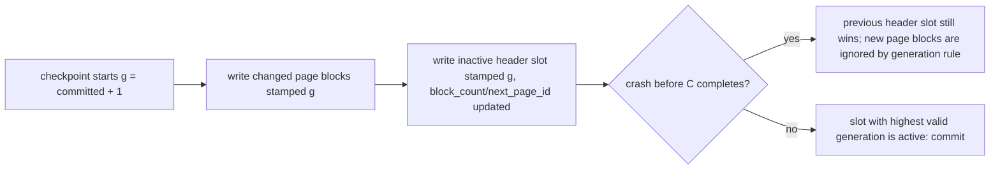

<!-- Copyright (c) 2026 Eleftherios Notas and The XIOM Authors -->
<!-- SPDX-License-Identifier: MIT OR Apache-2.0 -->
# Byte-page format v2 -- design (M1.2)

> Status: **DESIGN** (2026-10-10). Implementation slices in
> `docs/checklists/byte-page-v2.md`. The pure codec (S1) is implementable on
> v0.64.2 today; the block store (S2) runs against the byte-IO shim; the
> default flips to v2 in S3, and S4 swaps the shim for real fixed-size IO +
> fsync when the stdlib storage rows land.
>
> Scope: replace the text page file / page log (FORMATS.md sections 3-4)
> with 4096-byte blocks: fixed-size IO, generation-stamped commit, CRC32C in
> the block header, torn-block detection, O(1)-ish appends, and a page
> directory that no longer needs a full-file parse. This is the last blocker
> for lazy load / bounded cache (M1.1b) and the pager seam (C3).

## 1. Why v2

The v1 page file is a text line per page (`page_id|len|checksum|b0,b1,...`):
correct, crash-proven, but every write rewrites the whole file (O(n)), every
read parses the whole file, and a `Vec[Int]` payload is ~4 bytes per byte
on disk with per-byte parsing overhead. v2 fixes IO shape and density:

- **Fixed 4096-byte blocks** so the future pager does pread/pwrite at
  `block_index * 4096` (real `read_at`/`write_at` when stdlib byte IO lands).
- **Generation-stamped commit preserved** from v1 (highest valid generation
  wins; readers ignore uncommitted newer pages) -- the v1 crash contract
  carries over unchanged, including the "header written last" rule.
- **Self-validating blocks**: magic/version/kind/length/CRC32C all inside the
  block, so a torn block is detected per block, not per file.
- **Density**: 8-byte keys/values are stored byte-wise (little-endian), not
  as decimal text; a node block is ~7x smaller on disk (v1 text vs 8-byte
  fields) and parsing is O(1) per field.

## 2. Block layout (4096 bytes)

Every block (header slot or page) shares the 32-byte block header:

| Offset | Size | Field | Notes |
|---|---|---|---|
| 0 | 4 | magic = `'O','P','G','2'` | `0x4F 0x50 0x47 0x32` |
| 4 | 1 | format_version = `2` | reader reject otherwise |
| 5 | 1 | kind | `'H'` = `0x48` header slot, `'P'` = `0x50` page, `'F'` = `0x46` free (aborted in-progress block) |
| 6 | 2 | flags (LE) | reserved `0`; bit0 = header slot "active" marker (informational; generation decides) |
| 8 | 8 | generation (LE) | commit stamp; header commit = highest valid generation |
| 16 | 8 | page_id (LE) | logical page id; `0` in header slots |
| 24 | 4 | payload_len (LE) | `0 <= len <= 4064` (strict) |
| 28 | 4 | crc32c (LE) | CRC32C of the payload bytes only |
| 32 | 4064 | payload | zero-padded; bytes `32+len .. 4096` MUST be zero |

**Page max payload = 4064 bytes** (4096 - 32 header). The v1 `Page` contract
allows 4096 payload bytes; v2 tightens the *store* capacity to 4064 and
`tuple_fits_page` must consult the active store's capacity (v1: 4096, v2:
4064). The 4064/4096 overhead is documented in FORMATS.md when v2 lands.

Header **slot** payload (block kind `'H'`, 64 bytes used):

| Offset | Size | Field |
|---|---|---|
| 0 | 4 | magic2 = `'O','H','D','2'` |
| 4 | 8 | root node index |
| 12 | 8 | order (`>= 3`) |
| 20 | 8 | node_count |
| 28 | 8 | checkpoint_lsn |
| 36 | 8 | committed_generation |
| 44 | 8 | block_count (file size in blocks) |
| 52 | 8 | next_page_id |
| 60 | 4 | reserved `0` |

Layout of the file:

```
block 0        header slot A
block 1        header slot B
block 2..N     page / free blocks (append order)
```

Two header slots kill the single-point torn write: a commit writes the slot
that is currently NOT active (generation g), then (after the slot bytes are
out) that slot becomes active by virtue of having the highest valid
generation. A torn write to the inactive slot leaves the previous active
slot untouched.

## 3. Commit protocol



- Readers resolve each page as the newest generation `<=` active header
  generation; a page block from an uncommitted g is ignored even if its CRC
  is valid. This is exactly the v1 rule, now at block granularity.
- A page block whose page_id is no longer referenced (rewritten later at a
  higher generation) is stale; compaction rewrites one block per live page.
- Compaction (same trigger as v1: raw blocks > live_pages + 64) writes all
  live pages at generation g+1 into a **temp file**, writes the new header
  slots, then `io.rename` (atomic replace) -- identical shape to the v1
  batch rewrite, in blocks.
- **Torn page blocks** (crash mid-append) are detected by magic/len/CRC and
  treated as absent: new appends happen after the last valid block
  (`block_count` from the active header is advisory; the reader validates).
- `'F'` blocks: a writer that knows a block is dead before the final header
  commit can stamp it `'F'`; readers skip them. Free-list reuse is out of
  scope for S2 (append-only + compaction is enough at this scale).

## 4. Byte-IO shim (`src/storage/byte_io.xi`, S2)

The store code NEVER calls `io.*` for block IO directly; it goes through a
one-page shim so the stdlib swap is a single-file change:

| Shim function | Contract today (S2) | When stdlib byte IO lands (S4) |
|---|---|---|
| `byteio_read_at(path, offset, len) -> Result[Vec[UInt8], IOError]` | whole-file `io.read_file_bytes` + slice (correct, O(file)) | real seek+read / `read_at` |
| `byteio_write_at(path, offset, bytes) -> Result[Unit, IOError]` | whole-file read + splice + `io.write_file_bytes` (correct, O(file)) | real pwrite / `write_at` |
| `byteio_append(path, bytes) -> Result[Unit, IOError]` | read+splice+write (same as above) | `io.append_file_bytes` (runtime row) |
| `byteio_file_size(path) -> Int` | `read_file_bytes` length | `stat` / seek-end |
| `byteio_truncate(path, len) -> Bool` | rewrite prefix (O(file)) | `fs_ffi.truncate` (runtime row) |
| `byteio_sync(path) -> Bool` | documented no-op (not durable) | `fsync` (stdlib row 1) |

Honesty: with the shim fallbacks the byte page store is **slower** than the
v1 text store on the same workload (same O(file) per write, plus byte
conversion). S2/S3 therefore land behind a config flag
(`DatabaseConfig.page_format = "v1" | "v2"`, default `"v1"`) and the flag
only flips in S3 after the full evidence matrix. The value of S1+S2 is the
frozen format + codec + crash contract so that S4 (stdlib) is a clean swap.

## 5. Codec API (S1, pure -- no IO)

New module `xiom.db.storage.block`:

```xiom
pub fn block_size() -> Int                      // 4096
pub fn block_payload_capacity() -> Int          // 4064
pub fn block_encode_page(generation: Int, page_id: Int, payload: &Vec[Int]) -> Vec[UInt8]
pub fn block_decode_page(bytes: &Vec[UInt8]) -> Option[BlockPage]
pub fn block_encode_header(h: &BlockHeader) -> Vec[UInt8]
pub fn block_decode_header(bytes: &Vec[UInt8]) -> Option[BlockHeader]
pub fn block_kind_is_free(bytes: &Vec[UInt8]) -> Bool   // 'F' fast path
```

`BlockPage = { generation: Int; page_id: Int; payload: Vec[Int]; }`
`BlockHeader` carries the header-slot payload fields above.

Decode is strict: exact 4096 length, magic/version/kind, `payload_len` in
range, CRC32C match, zero padding (a non-zero pad byte is corruption), and
`kind == 'P'` for pages. Rejects are `None` -- no partial pages, matching the
v1 "strict decode, no silent acceptance" rule.

## 6. Migration (v1 -> v2)

- Same default path `<db>.snap`; format auto-detected by the first byte
  (v1 lines start with a digit or the file is empty; v2 starts with `'O'`).
- `page_file_v2_migrate(v1_path, v2_path)`: read v1 (existing reader), write
  every page as one v2 block at `generation = v1_generation + 1`, write both
  header slots, temp+rename. Idempotent when `v2_path` already exists and
  validates.
- Downgrade is NOT automatic: v1 readers fail loudly on the v2 magic
  (documented in FORMATS.md at S3). A reverse migration tool is a follow-up
  only if a consumer needs it (no consumer on `.snap` internals today).
- FORMATS.md gains a "section 3v2" at S3 with the frozen tables from this
  document and the `wal 1` / page `v2` compatibility matrix row.

## 7. Test plan (evidence per slice)

- **S1**: byte-exact KATs (hex literal tables for a page block and a header
  slot), boundaries (`len` 0 / 1 / 4064 / 4065-rejected), corruption matrix
  (flip a byte in each header field + payload + padding -> `None`), fuzz:
  random page sets encode->decode==input (extend `probe_fuzz.xi`).
- **S2**: block-store probe mirroring `probe_page_file.xi` (append/read/
  latest-wins/compaction) + crash harness `scripts/`-style: writer hard-kill
  at every named state (after page blocks, after inactive header, mid-slot),
  torn tail, torn header slot, uncommitted generation ignored, compaction
  crash; x2 Windows + WSL.
- **S3**: full matrix -- suite x2, page/db crash x2, fuzz, 2000-key soak --
  with `page_format = "v2"` and (after flip) default; FORMATS.md + API.md +
  RUNBOOK updated.
- **S4**: stdlib byte IO + fsync swap; re-run S2/S3 matrix; then M1.1b lazy
  load + C3 pager use real fixed-size IO; power-loss fault injection enters
  via the fsync seam (M2.1).

## 8. Open questions (resolve in S1/S2)

1. Block size for the B-tree node store: 4096 flat (chosen) vs 8192 with two
   slots per block -- 4096 matches `config.page_size` and the clock replacer
   frames; revisit only if node payloads approach 4064.
2. Free-list: skip until a workload shows compaction pressure; `'F'` blocks
   plus compaction are sufficient now.
3. Page directory persistence: S2 rebuilds page_id -> block by scanning
   valid blocks at open (O(blocks), ~ms at 1M blocks). Persist a directory
   only if open cost shows up in the benchmark (G1) -- the header has
   `next_page_id` ready for a map extension.
4. `config.page_size` semantics: v2 keeps 4096 as the logical page size and
   documents the 32-byte overhead; no config change.
