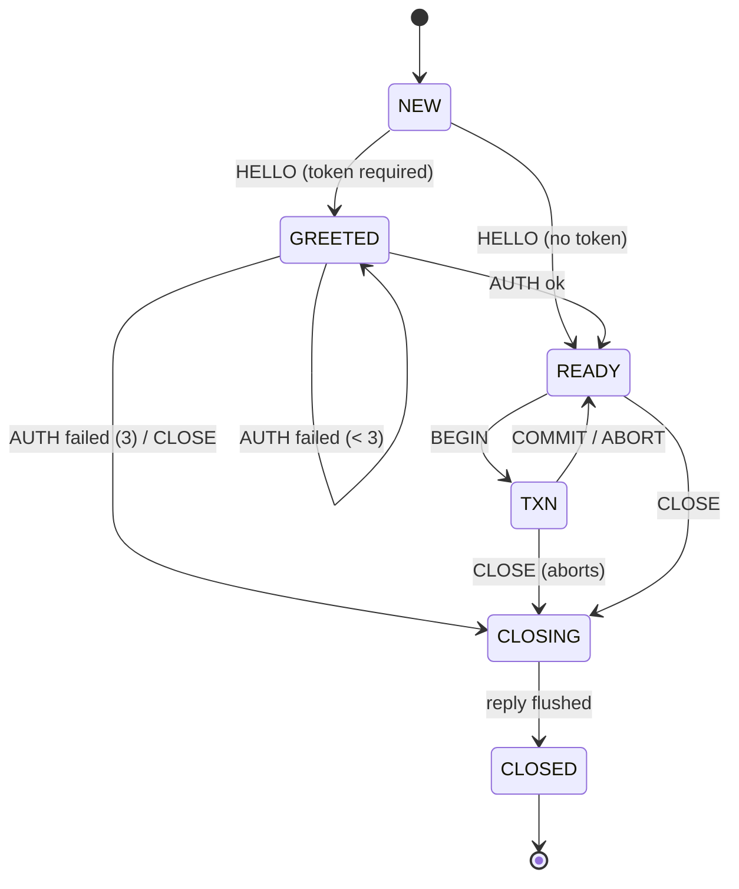

# ORBITWIRE v1 -- Station wire protocol

> **Status:** FROZEN for ST1 (2026-10-21). Protocol version **1**. Transport:
> raw TCP on the loopback interface. Implementation:
> `station/src/protocol.xi` (pure codec), `station/src/session.xi` (ingress /
> egress + bounded queue), `station/src/dispatch.xi` (session state machine +
> engine actor), `station/src/server.xi` (poll loop). Conformance:
> `station/tests/{protocol,session,loopback}_suite.xi` -- **169 checks x2 on
> Windows and x2 on WSL** (2026-10-21).
>
> ORBITWIRE is the Station's typed binary session protocol, not HTTP. The
> admin/HTTP plane stays on PULSE; the two do not share a listener.

## 1. Scope and design rules

- **Typed frames, not SQL text.** Every command is a typed op with a small
  field dictionary; a `QUERY` carries plan intent (conditions, bounds, order,
  limit, offset), never a query string.
- **One engine, one actor.** The Station composes the Satellite engine
  through its public `db_file_*` API. A `StationActor` owns exactly one
  `DBFile` (one shard); sessions submit commands to the actor and never hold
  the handle.
- **Single writer.** v1 exposes one transaction window per shard, owned by at
  most one session at a time; other sessions read committed state and their
  writes are refused with `TXN_ACTIVE`. This is the ST3 serialization point
  made explicit early.
- **Bounded everything.** Frame, header, payload, field count, outbound
  queue, sessions, auth attempts, transaction ops, range/query rows.
- **No DBFile across threads.** ST1 is a single-threaded event loop on
  purpose; ST3 may move the actor behind a thread boundary but the dispatch
  messages (and therefore the wire) do not change.

## 2. Transport and connection lifecycle

| Item | v1 |
|---|---|
| Transport | TCP, `AF_INET` (loopback by default) |
| Default bind | `127.0.0.1` (`ORBITDB_STATION_BIND`) |
| Default port | `7767` (`ORBITDB_STATION_PORT`); `0` -> first free `17867+` |
| Session | one TCP connection |
| Ordering | requests are processed in arrival order; responses are emitted in order (single-threaded) |
| Pipelining | allowed; one terminal response per request (`TAG_REQUEST_ID` correlates) |
| Idle timeout | none in v1 (the client or operator closes) |
| TLS | not yet (ST6); the default bind is loopback |
| Session resume | none in v1; a new connection starts at `NEW` |

The first successful op on a connection **must** be `HELLO`. If the Station
is configured with a token, `AUTH` must follow before any data op. `CLOSE`
(and EOF) are the only terminal paths; `CLOSE` aborts a transaction owned by
that session before replying.

## 3. Frame format

All integers are **little-endian**. A frame is:

| Offset | Size | Field | Value |
|---|---|---|---|
| 0 | 4 | magic | `4F 42 57 31` (`"OBW1"`) |
| 4 | 1 | version | `1` |
| 5 | 1 | kind | `1` = REQUEST, `2` = RESPONSE |
| 6 | 1 | flags | `0` in v1 (unknown -> protocol error) |
| 7 | 1 | reserved | `0` (nonzero -> protocol error) |
| 8 | 4 | header_len | u32 |
| 12 | 4 | payload_len | u32 |
| 16 | N | header | typed field list (section 4) |
| 16+N | M | payload | op-specific bytes (section 6) |
| 16+N+M | 4 | crc32c | u32 over bytes `[4, 16+N+M)` |

`total = 20 + header_len + payload_len`. The CRC is CRC32C/Castagnoli with the
same reflected polynomial and init/final values as `docs/FORMATS.md` section 1
(`0x82F63B78`, init `0xFFFFFFFF`, final xor `0xFFFFFFFF`); the protocol suite
cross-checks the local implementation against the engine page checksum.

A frame with a bad magic/version/CRC, a nonzero flag/reserved byte, an
unknown field type, a trailing byte inside the header, or a length above the
caps is a **fatal framing error**: the Station sends one error frame with
request id `0` when it can still frame the error, then closes the session.

### 3.1 KAT (request, 61 bytes)

`frame_encode(KIND_REQUEST, [REQUEST_ID=7, OP=PING, NONCE=42], [01 02 03])`:

```
4f425731 01 01 00 00 26000000 03000000
0300 0100 0800 0700000000000000
     0200 0800 0100000000000000
     1000 0800 2a00000000000000
010203
44cd3dcb
```

(Whitespace/line breaks are illustrative; the canonical bytes are the
concatenation. Header length is `0x26` = 38, payload length 3, CRC
`0xcb3dcd44` in LE byte order.)

## 4. Header field list

```
u16 field_count                       (<= MAX_FIELDS)
repeat field_count times:
  u8  tag
  u8  type                            (0 INT, 1 BOOL, 2 TEXT, 3 BYTES)
  u16 value_len
  value bytes
```

- **INT**: `value_len == 8`, two's-complement i64 LE.
- **BOOL**: `value_len == 1`, `0` or `1`.
- **TEXT**: UTF-8 bytes, `value_len` bytes.
- **BYTES**: opaque bytes, `value_len` bytes.
- Unknown **tags** are ignored (forward compatibility). Unknown **types**,
  bad lengths, a duplicate `field_count` mismatch, or leftover header bytes
  are protocol errors.
- Scalar tags are single-valued; readers take the first occurrence. Tags
  documented as repeated (`TAG_CONDITION`) are collected in order.

### 4.1 Field dictionary

| Tag | Name | Type | Used by |
|---|---|---|---|
| 1 | `TAG_REQUEST_ID` | INT | every request/response |
| 2 | `TAG_OP` | INT | every request/response |
| 3 | `TAG_STATUS` | INT | response (`0` OK, `1` ERROR) |
| 4 | `TAG_CODE` | INT | error responses |
| 5 | `TAG_PROTO_VERSION` | INT | HELLO |
| 6 | `TAG_SERVER_VERSION` | TEXT | HELLO |
| 7 | `TAG_CAPABILITIES` | INT | HELLO (bit mask) |
| 8 | `TAG_SESSION_ID` | INT | HELLO |
| 9 | `TAG_AUTH_REQUIRED` | BOOL | HELLO |
| 10 | `TAG_MAX_FRAME` | INT | HELLO |
| 11 | `TAG_MAX_PAYLOAD` | INT | HELLO |
| 12 | `TAG_MAX_QUEUE` | INT | HELLO |
| 13 | `TAG_TXN_OPEN` | BOOL | BEGIN/COMMIT/ABORT/PING/CLOSE |
| 14 | `TAG_ROW_COUNT` | INT | RANGE/QUERY |
| 15 | `TAG_MESSAGE` | TEXT | error responses |
| 16 | `TAG_NONCE` | INT | PING |
| 17 | `TAG_METHOD` | INT | AUTH (`1` = token) |
| 18 | `TAG_KEY` | INT | PUT/GET/DELETE/PUT/PUT responses |
| 19 | `TAG_VALUE` | INT | PUT (int rows), GET (int rows) |
| 20 | `TAG_ROW_KIND` | INT | PUT/GET/RANGE (`0` int, `1` typed) |
| 21 | `TAG_LOW` | INT | RANGE/QUERY bounds |
| 22 | `TAG_HIGH` | INT | RANGE/QUERY bounds |
| 23 | `TAG_LIMIT` | INT | RANGE/QUERY |
| 24 | `TAG_OFFSET` | INT | QUERY |
| 25 | `TAG_ORDER` | INT | QUERY (`0` key asc, `1` value asc, `2` value desc) |
| 26 | `TAG_HAS_BOUNDS` | BOOL | QUERY |
| 27 | `TAG_CONDITION` | BYTES (9) | QUERY, repeated: `op u8 + i64 LE` |
| 28 | `TAG_LAST_LSN` | INT | HELLO/PING/BEGIN/COMMIT/ABORT/CHECKPOINT/PUT/DELETE |
| 29 | `TAG_DB_SIZE` | INT | HELLO |
| 30 | `TAG_TOKEN` | BYTES | AUTH |
| 31 | `TAG_TRUNCATED` | BOOL | RANGE |

Condition op codes match `QueryOp`: `0 Eq`, `1 Neq`, `2 Lt`, `3 Lte`,
`4 Gt`, `5 Gte`.

Capability bits in `TAG_CAPABILITIES`: `1` typed rows, `2` transactions,
`4` query, `8` checkpoint, `16` auth.

## 5. Op set

| Code | Op | Request fields | Response fields / payload |
|---|---|---|---|
| 1 | `HELLO` | `PROTO_VERSION` (optional, default 1) | fixed HELLO fields |
| 2 | `AUTH` | `METHOD`, `TOKEN` (BYTES) | `TXN_OPEN`, `LAST_LSN` |
| 3 | `PING` | `NONCE` | `NONCE`, `TXN_OPEN`, `LAST_LSN` |
| 4 | `BEGIN` | -- | `TXN_OPEN=true`, `LAST_LSN` |
| 5 | `PUT` | `KEY`, `ROW_KIND`, (`VALUE` for int; payload bytes for typed) | `KEY`, `LAST_LSN` |
| 6 | `GET` | `KEY` | `ROW_KIND`, `KEY`, `VALUE` or typed payload |
| 7 | `RANGE` | `LOW`, `HIGH`, `LIMIT` (optional) | `ROW_COUNT`, `TRUNCATED`, row stream |
| 8 | `QUERY` | repeated `CONDITION`, optional bounds/order/limit/offset | `ROW_COUNT`, value stream |
| 9 | `COMMIT` | -- | `TXN_OPEN=false`, `LAST_LSN` |
| 10 | `ABORT` | -- | `TXN_OPEN=false`, `LAST_LSN` |
| 11 | `CLOSE` | -- | `TXN_OPEN=false`; server closes after the reply |
| 12 | `DELETE` | `KEY` | `KEY`, `LAST_LSN` |
| 13 | `CHECKPOINT` | -- | `LAST_LSN` (the anchor LSN) |

The required ST1 op set is `HELLO/AUTH/PING/BEGIN/PUT/GET/RANGE/QUERY/COMMIT/
ABORT/CLOSE`; `DELETE` and `CHECKPOINT` are additive v1 ops so the whole
public write surface is expressible. `PREPARE/EXECUTE/FETCH` are **not** in
v1: a QUERY is already a typed plan and the engine executes it directly; a
future v1.1 may add prepared handles without breaking this frame format.

### 5.1 Payload codecs

- **Row stream** (`RANGE` response): `u32 count`, then per row:
  `u8 kind`, `i64 key`, `u32 value_len`, then `i64 value` for `kind=0` or
  `value_len` row bytes for `kind=1`. Max `MAX_WIRE_ROWS` rows.
- **Value stream** (`QUERY` response): `u32 count`, then `count` i64 values
  LE. `QUERY` returns the engine's value-filter results in execution order
  (key ascending, or the requested value order); RANGE is the keyed view.
- **Typed rows** are the engine's tuple-v2 row bytes (`docs/FORMATS.md` 5A),
  carried opaquely. The wire does not decode or rewrite them; the client and
  the engine agree on the row codec. This is how all `TValue` kinds (null,
  int, float, text, blob) round-trip without a second value codec.

### 5.2 Op semantics

- **HELLO**: only in `NEW`. Protocol version must be 1. If a token is
  configured the session moves to `GREETED`, otherwise directly to `READY`.
  HELLO advertises the limits in section 7 and the current `LAST_LSN` /
  `DB_SIZE`.
- **AUTH**: only in `GREETED`; method 1 (shared token). On success -> `READY`;
  on failure the session stays `GREETED` and increments its failure count.
  The third failure returns `AUTH_LOCKED` and closes the session.
- **PING**: `READY`/`TXN`; no engine mutation.
- **BEGIN**: `READY` only; fails with `TXN_ACTIVE` if any session owns the
  shard's transaction window. The caller becomes the owner.
- **PUT**: int rows work in `READY` (auto-commit) and `TXN` (buffered);
  typed rows are **auto-commit only in v1** (the engine's typed txn path is a
  later additive API) and return `UNSUPPORTED` inside a transaction. A typed
  payload above `db_file_typed_payload_max(order)` returns `LIMIT`.
- **GET**: `READY`/`TXN`; reads committed state. A typed payload wins over
  the mirrored int value.
- **RANGE**: `READY`/`TXN`; inclusive `[low,high]`, key order, typed rows
  returned as typed rows. Default limit 500, max 1000, `TRUNCATED=true` when
  more keys matched. A span above 10,000 keys is refused with `LIMIT` so one
  request cannot allocate unbounded memory.
- **QUERY**: `READY`/`TXN`; conditions filter values (engine semantics),
  optional key bounds narrow the scan first, `order` is applied before
  `offset`/`limit` (the engine's M4.2 rule), max 5,000 results.
  `TAG_ORDER` is written directly to the engine query (`0/1/2`).
- **COMMIT/ABORT**: `TXN` and the session must own the window; otherwise
  `NO_TXN`. `COMMIT` appends the WAL commit record before the tree apply
  (engine contract); `ABORT` discards the buffer.
- **DELETE**: int rows; `TXN` buffered or `READY` auto-commit; absent key ->
  `NOT_FOUND`.
- **CHECKPOINT**: `READY` only; refused with `TXN_ACTIVE` while any
  transaction is open; returns the anchor LSN.
- **CLOSE**: allowed in `GREETED`/`READY`/`TXN`. A transaction owned by this
  session is aborted first. The server flushes the CLOSE reply, then closes.

## 6. Session state machine



| State | Allowed ops |
|---|---|
| `NEW` | HELLO |
| `GREETED` | AUTH, CLOSE |
| `READY` | PING, BEGIN, PUT, GET, RANGE, QUERY, DELETE, CHECKPOINT, CLOSE |
| `TXN` | PING, PUT, GET, RANGE, QUERY, DELETE, COMMIT, ABORT, CLOSE |
| `CLOSING`/`CLOSED` | none (CLOSED -> `CLOSED` error if a frame arrives before the fd closes) |

Any other op in a state returns a non-fatal `PROTOCOL` error (the session
stays usable); only framing errors, auth lockout and CLOSE are terminal.

## 7. Errors

`TAG_STATUS` is `0` (OK) or `1` (ERROR). Error responses carry `TAG_CODE` and
a human-readable `TAG_MESSAGE` (never used for control flow).

| Code | Name | Origin |
|---|---|---|
| 0 | `OK` | -- |
| 1 | `PROTOCOL` | framing, state, missing/invalid field |
| 2 | `AUTH_REQUIRED` | data op before AUTH |
| 3 | `AUTH_FAILED` | wrong token |
| 4 | `NOT_FOUND` | GET/DELETE absent key (`DbError.NotFound`) |
| 5 | `DUPLICATE_KEY` | `DbError.DuplicateKey` (no v1 op produces it) |
| 6 | `CONSTRAINT` | `DbError.ConstraintViolation`, low>high, bad order/limit |
| 7 | `SCHEMA_MISMATCH` | `DbError.SchemaMismatch` |
| 8 | `STORAGE` | `DbError.StorageError`, failed/latched handle, checkpoint failure |
| 9 | `CORRUPTION` | `DbError.Corruption` |
| 10 | `LIMIT` | frame/header/payload/rows/ops/span cap |
| 11 | `TXN_ACTIVE` | another session owns the txn; CHECKPOINT during txn |
| 12 | `NO_TXN` | COMMIT/ABORT without ownership |
| 13 | `STALE_HANDLE` | reserved (the engine's stale-writer guard maps to STORAGE today) |
| 14 | `CLOSED` | frame after CLOSE |
| 15 | `INTERNAL` | encode/response failure |
| 16 | `UNSUPPORTED` | typed PUT inside TXN; unknown op |
| 17 | `AUTH_LOCKED` | three failed AUTH attempts |

Retryability follows the engine: `STORAGE` may be transient; logical codes
are not retryable. A latched engine handle requires a reopen (ST2 restart).

## 8. Limits and backpressure

| Limit | Value | Enforcement |
|---|---|---|
| `MAX_FRAME_BYTES` | 1,048,576 | hard backstop |
| `MAX_HEADER_BYTES` | 65,536 | frame peek/decode |
| `MAX_PAYLOAD_BYTES` | 524,288 | frame encode/decode |
| `MAX_FIELDS` | 64 | header decode |
| `MAX_QUEUE_BYTES` | 4,194,304 | per-session outbound queue |
| `MAX_SESSIONS` | 64 | accept (closed slots are reused) |
| `MAX_AUTH_FAILURES` | 3 | AUTH |
| `DEFAULT_RANGE_ROWS` | 500 | RANGE default |
| `MAX_RANGE_ROWS` | 1,000 | RANGE limit cap |
| range span guard | 10,000 keys | RANGE pre-check |
| `MAX_QUERY_ROWS` | 5,000 | QUERY result cap |
| `MAX_WIRE_ROWS` | 4,096 | row-stream count cap |
| `MAX_TXN_OPS` | 10,000 | buffered txn ops per session |

Backpressure is credit-by-budget at the session level:

1. A response is encoded and appended to the session's outbound queue only
   if it fits under `MAX_QUEUE_BYTES`.
2. `session_flush` sends what the socket accepts (`socket_send`) and keeps
   the unsent tail; a partial send resumes on the next event-loop tick.
3. While `pending >= MAX_QUEUE_BYTES` the server does **not** read more
   requests from that session (the poll loop still flushes it).
4. A single response that cannot fit the queue marks the session closing
   (not reachable under the frame caps; it is a defensive invariant).

There is no request retry and no response replay; a dropped connection is a
new session. Request ids are echoed, not deduplicated.

## 9. Authentication

- Configured by `ORBITDB_STATION_TOKEN`; empty means AUTH is not required and
  HELLO moves straight to `READY`.
- Method 1 is a shared secret carried in `TAG_TOKEN` (BYTES). The comparison
  is length-checked and byte-accumulated (no early exit).
- The failure counter is per session; three failures return `AUTH_LOCKED` and
  close. There is no global rate limiter in v1 (ST6 adds users/TLS).
- HELLO advertises `TAG_AUTH_REQUIRED` so clients do not guess.

## 10. Actor and threading model

```
client -> TCP session -> session_pull -> dispatch(actor, session)
                                           |
                                           v
                                     StationActor
                                     (one DBFile)
```

- The event loop is a single thread; `StationServer` owns the actor and the
  sessions. A `DBFile` is created, used and closed on that thread only.
- `db_file_open_locked_checked_cfg` takes the M3 shard lock, so a second
  Station on the same file fails fast; the lock is released on shutdown or
  process exit.
- `STATION` never calls private engine helpers; only the public `db_file_*`
  surface documented in `docs/API.md`.
- ST3 will move `StationActor` behind a dedicated thread with a message
  queue and add reader snapshots via `db_file_snapshot_*`; the wire surface
  and dispatch messages stay as defined here.

## 11. Reference extraction (REFERENCE-MATRIX 3.2)

| Reference mechanic | ORBITWIRE v1 conversion |
|---|---|
| h11 connection state machine + `receive_data`/`next_event` | `SessionState` (`STATE_*`) + `session_feed` / `session_pull`; EOF is a close state |
| fastify fixed hook order + one terminal send | auth gate -> state gate -> field parse -> engine dispatch -> one response queue entry |
| gin context `Next`/`Abort` | explicit dispatch gates; abort is an error frame plus an optional close, never an exception |
| knex builder -> compiler -> runner | QUERY condition/bounds/order fields -> `Query` -> `db_file_query`; the wire never carries SQL |
| bullmq token lock + renewal | M3 `file_lock` now; replica lease/fencing is ST4 (not in v1) |
| credit/backpressure + resumable writes | bounded outbound queue, read pause at budget, partial-send resume from `out_at` |

## 12. Versioning policy

- `PROTO_VERSION` is `1`; a reader rejects any other version at HELLO (and
  the frame prefix check rejects mismatches before HELLO).
- Header **tags** are additive: new optional tags may appear in either
  direction and old readers ignore them. Removing or changing a tag's type is
  a version bump.
- Op codes and error codes are stable; new ops take new codes.
- The frame prefix (magic/version/kind/flags/reserved/lengths/CRC) is frozen
  for v1. `FLAGS` is reserved and must be zero; future flags will be gated by
  HELLO capabilities.
- Payload codecs (row/value streams, tuple-v2 row bytes) are versioned by
  their own formats; the wire does not re-encode them.

## 13. Conformance and evidence

| Suite | Checks | Scope |
|---|---|---|
| `station/tests/protocol_suite.xi` | 33 | frame KAT, CRC parity, typed fields, limits, corruption, row/value streams |
| `station/tests/session_suite.xi` | 28 | partial/pipelined ingress, CRC/limit rejection, bounded queue, response builders |
| `station/tests/loopback_suite.xi` | 108 | HELLO/AUTH, CRUD, RANGE, QUERY order/limit/offset, txn visibility, typed all-kinds, payload limit, multi-session isolation, framing error, CHECKPOINT, CLOSE, lockout |

Run: `scripts/station_suite.ps1` (Windows) / `scripts/station_suite.sh`
(WSL; `scripts/wsl_ext4.sh ./scripts/station_suite.sh`). The runner executes
every suite twice and requires identical P/T with zero failures.

**2026-10-21 evidence:** 169/169 x2 Windows and 169/169 x2 WSL, station suite
GREEN.

## 14. Known limits / next

- **TLS** is not in v1 (ST6); keep the bind loopback until it lands.
- **QUERY returns values**, not keyed rows (the engine's value-filter
  semantics); use RANGE for keyed rows. A future typed-query op can return
  keys/rows.
- **Typed rows are auto-commit only** in v1 (no typed `BEGIN`/`PUT`); the
  engine's typed txn path is a later additive API.
- **One transaction per shard**, one owner; no cross-session or cross-shard
  transactions (ST4/ST5).
- **No savepoints** on the wire (the engine has them); no PREPARE/FETCH.
- **No session resume, no event push**, no notifications.
- **No per-user auth** or TLS client certificates; a shared token only.
- **Blocking send in v1.** The bounded queue pauses reads under budget, but
  `socket_send` itself is blocking; a peer that stops reading can stall the
  loop once the queue has drained into the kernel buffer. ST2 adds a
  nonblocking/partial-send seam (needs an EAGAIN distinction from stdlib) and
  a send timeout. Keep clients reading until CLOSE.
- The server does not fsync outside the engine's durability policy; the
  engine's `durability` default (1 = immediate) is used as-is.
